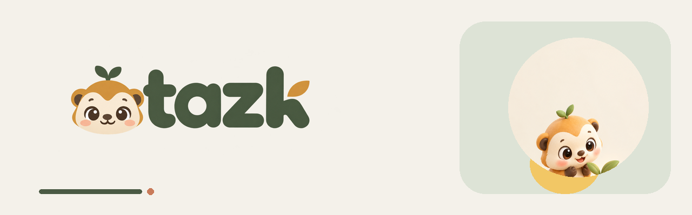
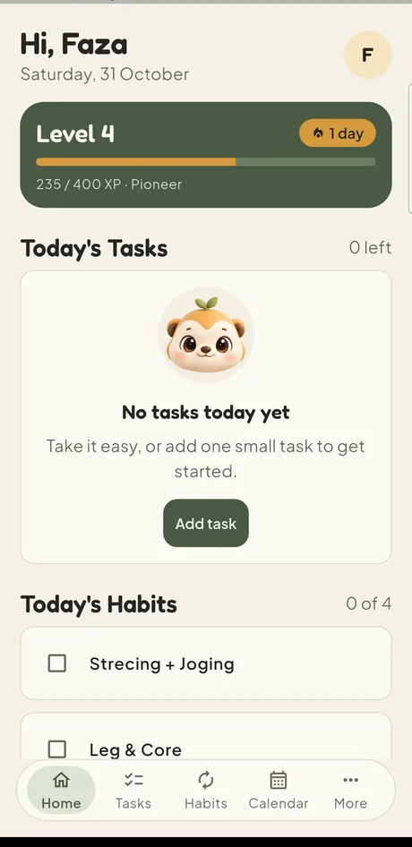
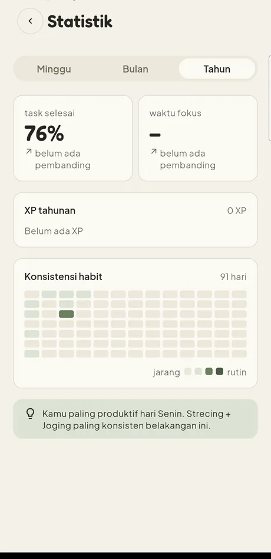
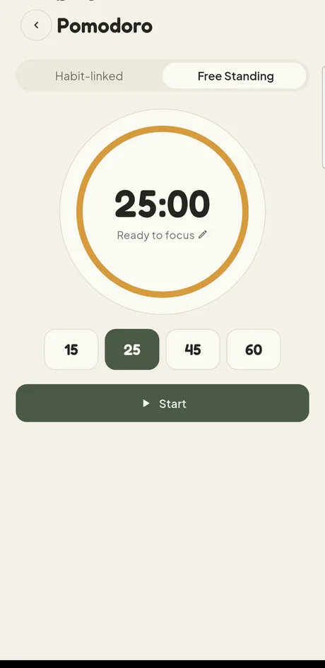

<p align="center">
  
</p>

<p align="center">
  
</p>

<h3 align="center">Tasks, habits, and focus in one calm daily workspace.</h3>

<p align="center">
  Offline-first Android app. No account, no ads, no cloud.
</p>

<p align="center">
  <a href="https://tazk-manager-mfdu.vercel.app"></a>
  <a href="https://github.com/MuhammadFaza-DU/Tazk-Android-App/actions/workflows/ci.yml"></a>
  
  
  
  
</p>

<p align="center">
  <a href="https://tazk-manager-mfdu.vercel.app">Website</a> ·
  <a href="https://tazk-manager-mfdu.vercel.app/privasi/">Privacy</a> ·
  <a href="docs/STATUS.md">Status</a> ·
  <a href="DESIGN.md">Design system</a> ·
  <a href="docs/LESSONS.md">Lessons</a>
</p>

---

## Screenshots

<p align="center">
  
  &nbsp;&nbsp;
  
  &nbsp;&nbsp;
  
</p>

<p align="center">
  <sub>Real captures from a Galaxy A52 running the v2.0 release build. Light theme, English.</sub>
</p>

---

## What it does

Tazk covers the short daily check-in: see what matters today, tick it off, keep a habit streak alive, run a focus session, and stop. Everything lives in a local SQLite database on the phone.

| Area | What you get |
|---|---|
| **Tasks** | Priority (high 15 / medium 10 / low 5 XP), date, time, location, subtasks that can auto-complete the parent, drag reordering |
| **Habits** | Daily, weekly, monthly, or custom schedules with per-date logs, so the calendar and today view never disagree |
| **Pomodoro** | 15/25/45/60 minute presets, editable durations (1 to 180 minutes), optional habit link |
| **Calendar** | Tasks and habits in one view, with a per-day detail panel |
| **Statistics** | Completion rate, focus minutes, XP per period, a 13×7 habit heatmap, and one insight line. A metric with no data shows a dash, never a fake zero |
| **Gamification** | XP, levels, streaks, freezes, badges, cosmetic unlocks |
| **Reminders** | Tasks, habits, streak warnings, and finished focus sessions |
| **Widgets** | Five home screen variants that follow the app theme, with scrollable lists |
| **Backup** | JSON export and import with a SHA-256 checksum |
| **Languages** | Indonesian and English, chosen during onboarding |
| **Update check** | Manual, from Settings. No background polling |

---

## Install

The app is distributed as a signed APK, not through the Play Store.

| | |
|---|---|
| Package | `com.tazk.tazk` |
| Version | `2.0.0` |
| Min SDK | `29` (Android 10) |
| Target SDK | `36` |
| Size | 54 MB (arm + arm64, single APK) |
| Signing | release keystore, per-ABI split builds also available |

**[Download from the website](https://tazk-manager-mfdu.vercel.app)** and check the SHA-256 shown on that page against the file you received.

On the phone: open the APK, and allow install from the browser or file manager when asked. If a debug build is already installed, uninstall it first, because debug and release use different signing keys and cannot replace each other.

---

## Privacy

Tazk stores everything on the device and asks for as little as possible.

| Permission | Why |
|---|---|
| Notifications | Reminders for tasks, habits, streaks, focus sessions |
| Exact alarm | Fire reminders on time instead of within a window |
| Boot completed | Re-arm reminders after a reboot |
| Battery optimisation exemption | Optional. Only affects whether widget taps are deferred while the app is idle |

What it does not do:

- No account, no sign-in, no analytics, no ads, no telemetry.
- No camera, microphone, location, or storage permission.
- **One network request exists**: the manual update check fetches `version.json` from this project's own landing page. It sends nothing about you and runs only when you tap that row.

Full text: [privacy page](https://tazk-manager-mfdu.vercel.app/privasi/).

---

## Tech stack

| Layer | Choice |
|---|---|
| Framework | Flutter 3.44.6 / Dart 3.12.2 |
| State | Riverpod 2.6 |
| Storage | Drift + SQLite, schema v8, every migration covered by a test |
| Notifications | flutter_local_notifications + timezone, exact alarms |
| Widgets | home_widget + Kotlin RemoteViewsService, own broadcast receiver for taps |
| Calendar | table_calendar |
| Backup | JSON + canonical SHA-256, share_plus and file_selector |
| Landing | Astro 7 on Vercel, gated for contrast, overflow, and page weight |

---

## Project layout

```text
lib/
  core/           theme tokens, shared widgets, motion, update service
  data/           Drift database, tables, repositories, models
  features/       home, tasks, habits, calendar, pomodoro, stats, profile, settings
  providers/      Riverpod wiring
  notifications/  scheduling and channels
  background/     midnight day rollover
  widgets/        widget push service
  l10n/           Indonesian and English ARB files
android/app/src/main/
  kotlin/         widget providers, RemoteViews factory, tap receiver
  res/layout/     widget layouts (RemoteViews-safe tags only)
landing/          Astro site: download page, privacy, version.json
docs/             STATUS, LESSONS, plans, artifacts
```

---

## Development

Prerequisites: Flutter SDK, Android SDK, JDK 17.

```bash
flutter pub get
dart analyze                          # must report 0 issues
flutter test                          # must be all green
flutter build apk --release --split-per-abi
```

Release signing reads `android/key.properties` and `android/*.jks`. Both are git-ignored and must never be committed.

Landing page:

```bash
cd landing
npm install
npm run dev
npm run check:gates    # contrast, overflow, reduced motion, page weight
```

README artwork is generated from the real source images, so it never drifts:

```bash
python tool/readme_assets.py     # banner + mascot animation
python tool/readme_screens.py    # cropped, compressed screenshots
```

---

## Documentation map

| File | Contents |
|---|---|
| [`docs/STATUS.md`](docs/STATUS.md) | Current position, open issues, what is verified and what is not |
| [`docs/LESSONS.md`](docs/LESSONS.md) | Failure ledger: each bug, its evidence, and the rule that prevents it |
| [`DESIGN.md`](DESIGN.md) | Design tokens and component rules (Sage and Sand, Dusk Forest) |
| [`PRD-v2.md`](PRD-v2.md) | Scope and requirements for v2 |
| [`docs/superpowers/specs/`](docs/superpowers/specs/) | The 16-stage upgrade design |

---

## Verification status

Claims in this README match what has been measured, not what was intended.

| Check | Result |
|---|---|
| `dart analyze` | 0 issues |
| `flutter test` | 602 tests, all green |
| CI (GitHub Actions) | passing on `main` |
| Landing gates | contrast AA light and dark, 0 horizontal overflow 320 to 1440, reduced motion honored, page under budget |
| Device run | v2.0 installed on a Galaxy A52 (Android 14); update check, profile, level-up celebration, widget taps, and the delete-task XP refund exercised by hand |
| APK integrity | published SHA-256 matches the uploaded artifact |
| Security review | Strix pentest, findings closed: non-exported widget receiver, 10 MB backup import cap, download host allowlist |

Known gaps are listed in [`docs/STATUS.md`](docs/STATUS.md) rather than hidden here.

---

## Design

Tazk ships one identity in two moods.

| | Light: Sage and Sand | Dark: Dusk Forest |
|---|---|---|
| Canvas | `#F4F1EA` | `#0F1A14` |
| Surface | `#FBF9F4` | `#152219` |
| Primary | `#4A5A44` | `#8FE0A9` |
| Accent | `#D69A3C` honey | `#F2C765` honey |
| Display type | Fredoka | Fredoka |
| Body type | Plus Jakarta Sans | Plus Jakarta Sans |

Tokens, component rules, and the motion scale live in [`DESIGN.md`](DESIGN.md). The mascot is an otter with a sprout, drawn for this project.

---

## Credits

Mascot and logo are original artwork for this project. Fonts are [Fredoka](https://fonts.google.com/specimen/Fredoka) and [Plus Jakarta Sans](https://fonts.google.com/specimen/Plus+Jakarta+Sans), both under the SIL Open Font License.

<p align="center">
  
</p>

<p align="center">
  <sub>Built with Flutter. Made to be used for two minutes, then closed.</sub>
</p>
